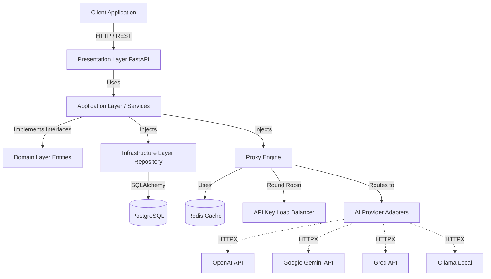
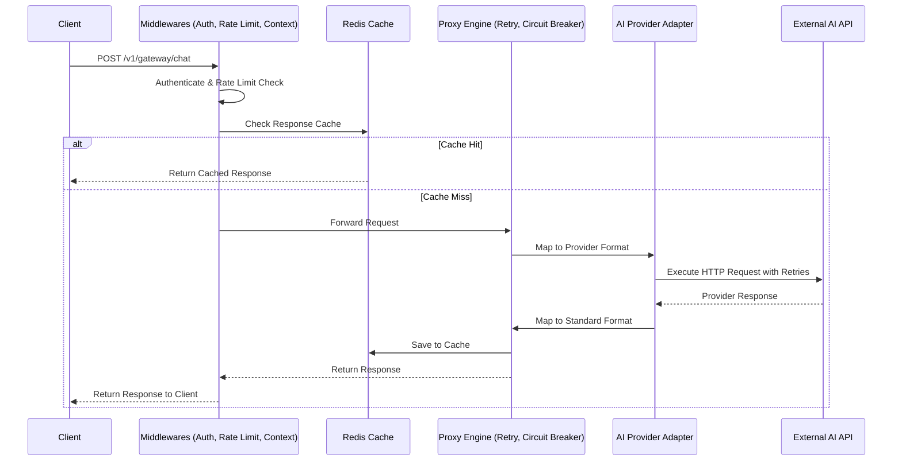
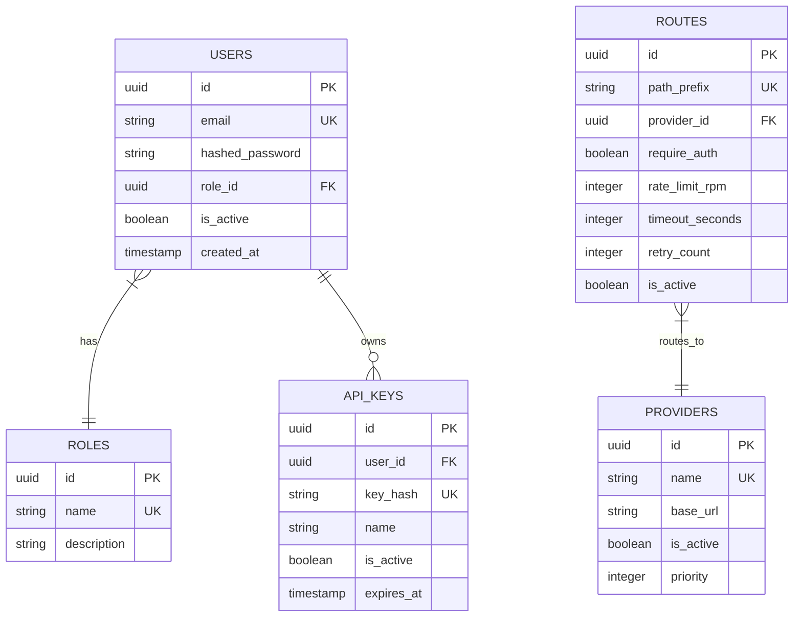

<div align="center">
  <h1>Enterprise AI API Gateway</h1>
  <p>A production-grade, highly scalable API Gateway for routing and managing traffic to multiple AI Providers (OpenAI, Gemini, Groq, Ollama), built with Python, FastAPI, and Strict Clean Architecture.</p>
</div>

---

## 📖 Overview

The **Enterprise AI API Gateway** is designed to serve as a unified, resilient, and observable entry point for AI-driven applications. Instead of hardcoding AI provider SDKs throughout your microservices, this gateway centralizes authentication, rate limiting, caching, and routing. 

If OpenAI experiences downtime, or you want to A/B test Gemini vs Groq, the Gateway handles it dynamically via its **Provider Adapter Pattern** and **Proxy Engine**.

## ✨ Key Features

- 🏗️ **Strict Clean Architecture**: The Domain layer is 100% decoupled from infrastructure frameworks (no SQLAlchemy in the domain).
- 🔌 **Dynamic AI Adapters**: Drop-in support for multiple AI vendors. Adding a new provider takes one adapter class.
- 🛡️ **Resilience & Fault Tolerance**: Built-in **Circuit Breakers** and **Exponential Backoff Retries** to handle upstream AI provider instability.
- 🚦 **Advanced Rate Limiting**: High-performance, atomic Redis Token Bucket rate limiting.
- ⚖️ **Load Balancing**: Round-Robin cycling across multiple vendor API keys to maximize throughput and avoid rate limits.
- 📊 **Enterprise Observability**: Prometheus metrics (latency, request counts) and Structlog for distributed tracing (`X-Trace-ID`).
- 🐳 **Containerized Infrastructure**: Fully orchestrated via Docker Compose (Gateway, PostgreSQL, Redis, Prometheus).

---

## 🏛️ Architecture Overview

The system adheres to Clean Architecture principles, ensuring that business logic is isolated from web frameworks and databases.



## 🔄 Request Lifecycle

Every request passes through a rigorous pipeline of security and resilience middlewares before hitting the upstream AI provider.



## 🗄️ Database Schema



---

## 🛠️ Tech Stack

| Category | Technology |
|---|---|
| **Backend Framework** | Python 3.12, FastAPI, Uvicorn |
| **Database & ORM** | PostgreSQL 15, SQLAlchemy 2.0 (asyncpg), Alembic |
| **Caching & Rate Limiting** | Redis 7, redis-py |
| **HTTP Proxy** | httpx |
| **Observability** | Prometheus Client, Structlog |
| **Security** | PyJWT, Passlib (bcrypt) |
| **Testing** | Pytest, Pytest-Asyncio |
| **DevOps** | Docker, Docker Compose, GitHub Actions |

---

## 🚀 Getting Started

### Prerequisites
- Docker and Docker Compose installed.

### 1. Spin up the infrastructure
```bash
cd deploy
docker-compose up -d --build
```
This will start the API Gateway (`:8000`), PostgreSQL (`:5432`), Redis (`:6379`), and Prometheus (`:9090`).

### 2. Run Database Migrations
Apply the SQLAlchemy schemas to the PostgreSQL database:
```bash
docker-compose exec gateway alembic revision --autogenerate -m "Initial migration"
docker-compose exec gateway alembic upgrade head
```

### 3. Access the APIs
- **Swagger UI (Interactive API Docs):** [http://localhost:8000/v1/docs](http://localhost:8000/v1/docs)
- **ReDoc:** [http://localhost:8000/v1/redoc](http://localhost:8000/v1/redoc)
- **Metrics Endpoint:** [http://localhost:8000/admin/metrics](http://localhost:8000/admin/metrics)

---

## 🧪 Running Tests

The project includes an extensive suite of unit and integration tests.

```bash
# Run tests inside the Docker container
docker-compose exec gateway pytest tests/ -v
```

## 📂 Directory Structure

```text
.
├── alembic/                      # Database migrations
├── app/                          
│   ├── api/                      # Presentation Layer (FastAPI Routers)
│   ├── application/              # Application Layer (Services & Use Cases)
│   ├── core/                     # Core configs, constants, logger
│   ├── domain/                   # Domain Entities & Interfaces (Pure Python)
│   ├── infrastructure/           # Database, Cache, Proxy Engine, AI Adapters
│   ├── middlewares/              # Rate Limiter, Context, Logging, Metrics
│   ├── schemas/                  # Pydantic validation (DTOs)
│   └── security/                 # JWT, Password Hashing
├── deploy/                       # Dockerfile & docker-compose.yml
├── tests/                        # Pytest suite
└── requirements.txt              # Dependencies
```

## 🛡️ License
This project is licensed under the MIT License.
