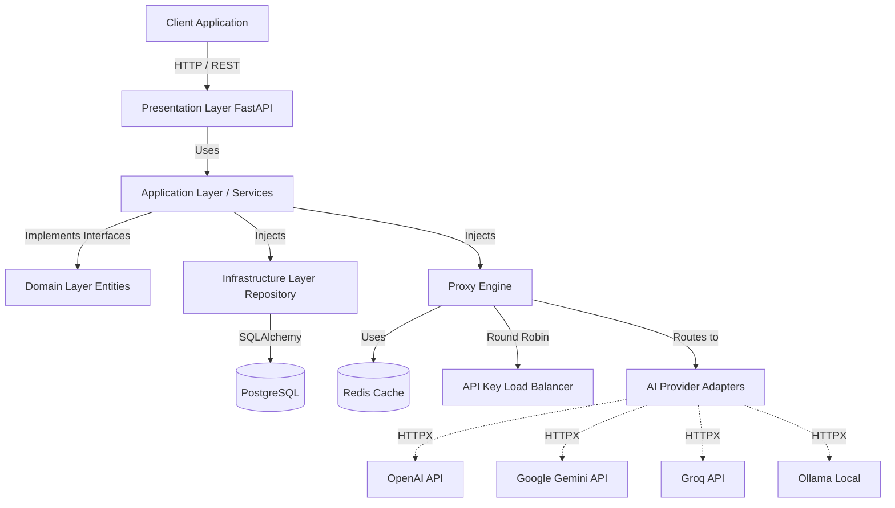
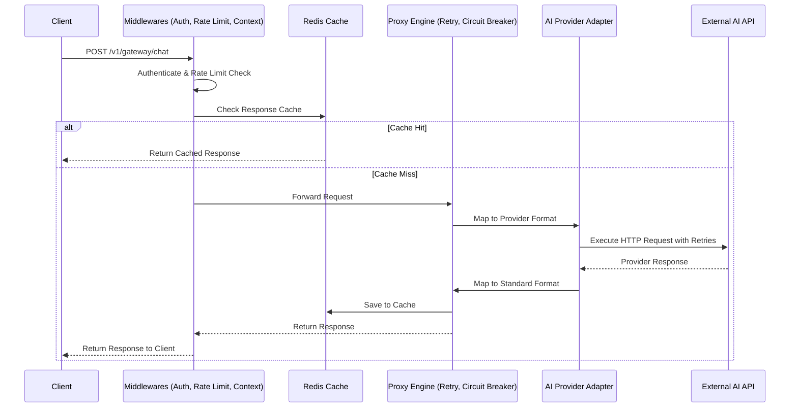
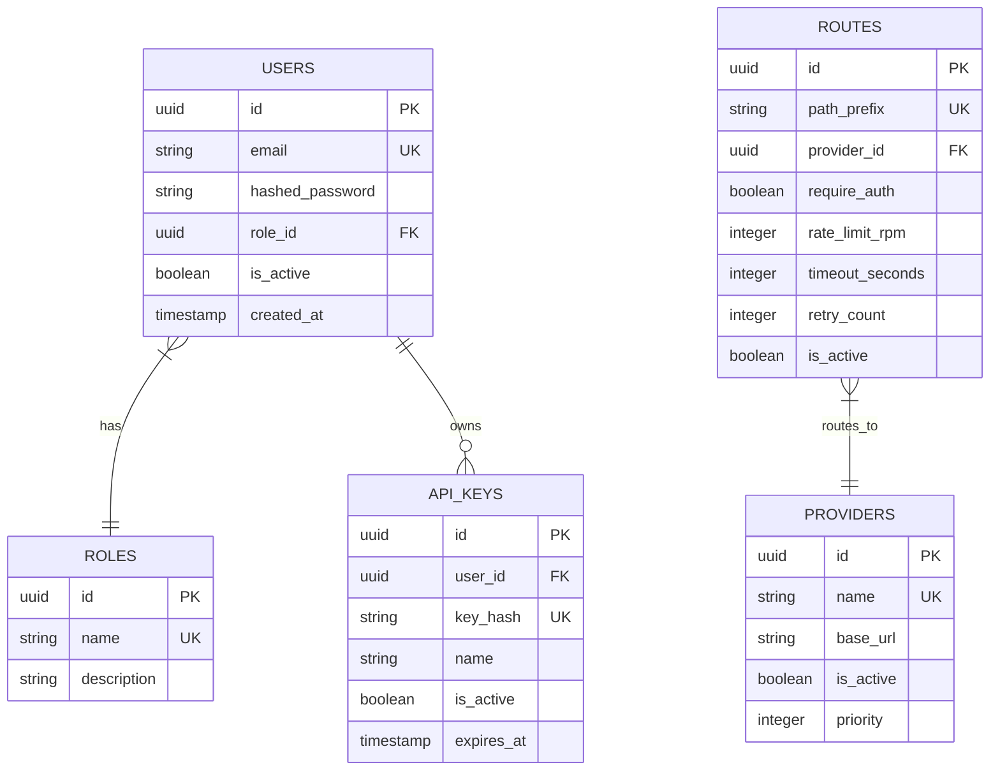

<div align="center">
  <h1>Enterprise AI API Gateway</h1>
  <p>A production-grade, highly scalable API Gateway for routing and managing traffic to multiple AI Providers (OpenAI, Gemini, Groq, Ollama), built with Python, FastAPI, and Strict Clean Architecture.</p>
</div>

---

## 📖 Overview

The **Enterprise AI API Gateway** is designed to serve as a unified, resilient, and observable entry point for AI-driven applications. Instead of hardcoding AI provider SDKs throughout your microservices, this gateway centralizes authentication, rate limiting, caching, and routing. 

If OpenAI experiences downtime, or you want to A/B test Gemini vs Groq, the Gateway handles it dynamically via its **Provider Adapter Pattern** and **Proxy Engine**.

## ✨ Key Features

- 🏗️ **Strict Clean Architecture**: The Domain layer is 100% decoupled from infrastructure frameworks (no SQLAlchemy in the domain).
- 🔌 **Dynamic AI Adapters**: Drop-in support for multiple AI vendors. Adding a new provider takes one adapter class.
- 🛡️ **Resilience & Fault Tolerance**: Built-in **Circuit Breakers** and **Exponential Backoff Retries** to handle upstream AI provider instability.
- 🚦 **Advanced Rate Limiting**: High-performance, atomic Redis Token Bucket rate limiting.
- ⚖️ **Load Balancing**: Round-Robin cycling across multiple vendor API keys to maximize throughput and avoid rate limits.
- 📊 **Enterprise Observability**: Prometheus metrics (latency, request counts) and Structlog for distributed tracing (`X-Trace-ID`).
- 🐳 **Containerized Infrastructure**: Fully orchestrated via Docker Compose (Gateway, PostgreSQL, Redis, Prometheus).

---

## 🏛️ Architecture Overview

The system adheres to Clean Architecture principles, ensuring that business logic is isolated from web frameworks and databases.



## 🔄 Request Lifecycle

Every request passes through a rigorous pipeline of security and resilience middlewares before hitting the upstream AI provider.



## 🗄️ Database Schema



---

## 🛠️ Tech Stack

| Category | Technology |
|---|---|
| **Backend Framework** | Python 3.12, FastAPI, Uvicorn |
| **Database & ORM** | PostgreSQL 15, SQLAlchemy 2.0 (asyncpg), Alembic |
| **Caching & Rate Limiting** | Redis 7, redis-py |
| **HTTP Proxy** | httpx |
| **Observability** | Prometheus Client, Structlog |
| **Security** | PyJWT, Passlib (bcrypt) |
| **Testing** | Pytest, Pytest-Asyncio |
| **DevOps** | Docker, Docker Compose, GitHub Actions |

---

## 🚀 Getting Started

### Run locally with Docker Compose
```bash
cd deploy
docker compose up -d --build
```
This starts the gateway (`:8000`), PostgreSQL, Redis and Prometheus (`:9090`). Migrations run automatically on boot, and a bootstrap admin (`admin@example.com` / `admin12345` unless you override `ADMIN_EMAIL` / `ADMIN_PASSWORD`) plus the default providers are created for you.

- **Swagger UI:** http://localhost:8000/v1/docs
- **Metrics:** http://localhost:8000/admin/metrics/

### Run locally without Docker
```bash
pip install -r requirements-dev.txt
cp .env.example .env          # set USE_REDIS=false if you have no Redis
alembic upgrade head
uvicorn app.main:app --reload
```

### Using the gateway
```bash
# 1. Register and log in (public registration always creates a regular user)
curl -X POST $URL/v1/auth/register -H 'content-type: application/json' -d '{"email":"me@example.com","password":"a-long-password"}'
TOKEN=$(curl -s -X POST $URL/v1/auth/login -H 'content-type: application/json' -d '{"email":"me@example.com","password":"a-long-password"}' | jq -r .access_token)

# 2. Chat through the gateway. Omit "provider" to let it pick by priority and fail over.
curl -X POST $URL/v1/gateway/chat/completions -H "Authorization: Bearer $TOKEN" -H 'content-type: application/json'   -d '{"provider":"groq","model":"llama-3.1-8b-instant","messages":[{"role":"user","content":"Hello"}]}'
```
Responses carry `X-Gateway-Provider` and `X-Gateway-Cache: HIT|MISS` headers. Upstream keys come from the `OPENAI_API_KEYS`, `GROQ_API_KEYS`, `GEMINI_API_KEYS` environment variables (comma-separate several to round-robin). Admins manage providers under `/v1/admin/providers/`. Streaming is not supported.

## ☁️ Free Hosting (Render + Neon)

The app is a single container that only needs a Postgres URL, so it fits entirely on free tiers:

| Piece | Service | Notes |
|---|---|---|
| App | [Render](https://render.com) free web service | Sleeps after ~15 min idle; first request after that takes ~30-60 s |
| Postgres | [Neon](https://neon.tech) free | Use this rather than Render's free Postgres, which expires |
| Redis (optional) | [Upstash](https://upstash.com) free | Skip it: set `USE_REDIS=false` for in-process rate limiting and cache |

1. Push this repo to GitHub.
2. In Neon, create a project and copy the connection string (`postgresql://...?sslmode=require`).
3. In Render choose **New + > Blueprint**, point it at the repo (it reads `render.yaml`), and fill in the prompted values: `DATABASE_URL`, `ADMIN_EMAIL`, `ADMIN_PASSWORD`, and at least one provider key (Groq has a free API tier). `SECRET_KEY` is generated for you.
4. Deploy. The container runs `alembic upgrade head` before starting, then serves on `$PORT`. Open `https://<your-service>.onrender.com/v1/docs`.

Production mode refuses to start with a weak `SECRET_KEY`, hides the load-test routes, and logs JSON. The same image works on any Docker host (Koyeb, Fly.io, Railway, a VPS): set the variables from `.env.example`.

Limits of the free setup: with `USE_REDIS=false` rate limits and the response cache are per-instance and reset on restart, which is fine on one instance. Add Upstash (`USE_REDIS=true` + `REDIS_URL`) before running more than one.

## 🧪 Running Tests

```bash
pip install -r requirements-dev.txt
pytest
```
Integration tests run the real app against SQLite with a mocked upstream, so no Postgres, Redis or API keys are needed.

## 📂 Directory Structure

```text
.
├── alembic/                      # Database migrations
├── app/                          
│   ├── api/                      # Presentation Layer (FastAPI Routers)
│   ├── application/              # Application Layer (Services & Use Cases)
│   ├── core/                     # Core configs, constants, logger
│   ├── domain/                   # Domain Entities & Interfaces (Pure Python)
│   ├── infrastructure/           # Database, Cache, Proxy Engine, AI Adapters
│   ├── middlewares/              # Rate Limiter, Context, Logging, Metrics
│   ├── schemas/                  # Pydantic validation (DTOs)
│   └── security/                 # JWT, Password Hashing
├── deploy/                       # Dockerfile, start.sh, docker-compose.yml
├── render.yaml                   # One-click Render blueprint
├── tests/                        # Pytest suite
└── requirements.txt              # Dependencies
```

## 🛡️ License
This project is licensed under the MIT License.
